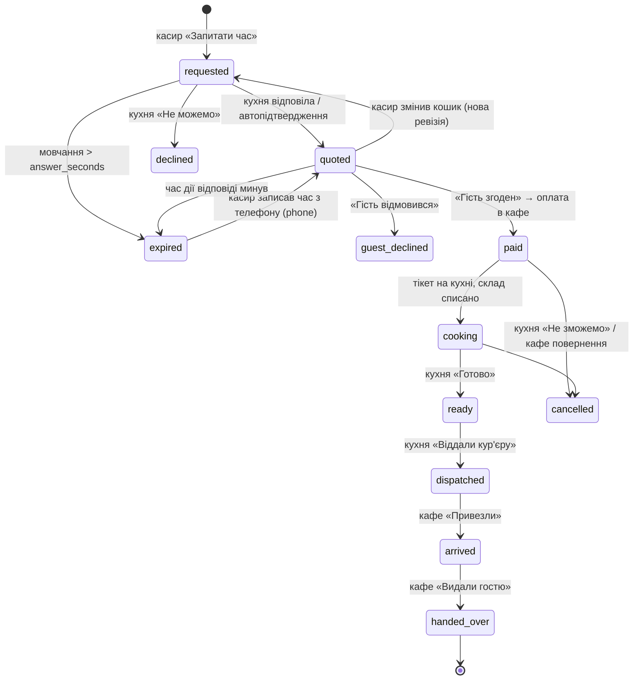

# Віддалена кухня: точка просить час, кухня підтверджує (модуль `remote-kitchen`)

Дизайн-док і **точка відновлення** треку РК (фази РК0–РК6, таблиця в §12). Коду ще немає: цей документ і
макети UX (`design/remote-kitchen/mockups.html`, опубліковано: https://claude.ai/artifact/FQCUqEd8AayEG92xAzdokM) лежать на затвердження власнику. Гілка
`feat/remote-kitchen-sync`, почато 2026-11-24 на `main` `7125aca`.

## 1. Запит власника (2026-11-24)

Клієнт — мережа «Пульчинелла» в Малині (піца, суші та роли, бургери, wok). Три точки (дані з сайту міськради,
див. §13): основна кухня з доставкою на вул. Степана Бандери, 11 (далі **кухня**, у запиті — «дарк-кітчен»),
**Pulcinella Park** у центральному парку, вул. Паркова, 3 (далі **точка** або **кафе**) і кав'ярня на
Грушевського, 22 (у цей трек не входить).

Як працює зараз (зі слів власника):

1. Кафе в парку продає лише з каси, без модуля столів. Хот-доги, нагетси, картоплю фрі готують на місці;
   замовлення приймають у Poster.
2. Піцу й суші кафе не готує. Касир **дзвонить на кухню** й питає, скільки чекати.
3. Гість погоджується — касир пробиває продаж, кухня готує, кур'єр везе в парк.

Що просить власник: частина товарів має позначку «готується в іншому місці». Коли касир набирає такий
товар, це схоже на новий раунд на кухню, але віддалену, і **не одразу**: спершу кухня має сказати, скільки
готувати. Два боки модуля: зручний запит часу на касі кафе і оцінка часу на боці кухні. Механіка має бути
автоматизована. Плюс доставка — заготовка під майбутній модуль доставки. На обох точках стоїть наша програма.

## 2. Теза

Дзвінок замінюємо **запитом із таймером**, а не новим каналом зв'язку. Касир не пише нічого руками: він набирає
піцу так само, як хот-дог, і натискає «Запитати час». Кухня бачить картку з уже порахованою пропозицією
(«25 хв: піца 18 + дорога 7») і відповідає одним тапом. Якщо кухня вмикає автопідтвердження, у звичайну
годину ніхто не тапає взагалі: сервер відповідає сам за секунду.

Три правила, на яких тримається все інше:

- **Нічого не готується й не списується, поки гість не погодився й не заплатив.** Це те саме правило, що в
  запитах гостя з QR-меню (Q6, `POS_QR_MENU.md`): запит живе в окремих таблицях, а не в продажу чи раунді.
- **Відповідь кухні — це обіцянка з терміном дії.** Час, названий о 19:05, гість приймає до 19:08. Після цього
  запит треба оновити одним тапом, бо черга на кухні вже інша.
- **Телефон лишається запасним виходом, а не помилкою.** Немає мережі або кухня мовчить — каса сама показує
  номер кухні й дає записати названий по телефону час, щоб замовлення все одно потрапило в облік.

## 3. Що вже є в коді й на що спираємось

| Що | Де | Як використовуємо |
|---|---|---|
| Окремі таблиці для запиту, який ще не продаж; приймання однією транзакцією; ідемпотентність за `client_uuid`; час життя запиту | `pos_guest_orders` (міграція 058), `src/pos/guest-orders.service.ts`, `POS_QR_MENU.md` Q6–Q9 | Та сама форма для `pos_remote_orders`: запит → відповідь → приймання. Ті самі ліміти й «одна 404» |
| Раунд, що списує склад у момент відправки на кухню, зі знімком складників | `fireRoundTx`, `pos_bill_item_components`, `POS_TABLES.md` | Кухня списує інгредієнти, коли оплачене замовлення переходить у «Готується». Знімок — для скасування |
| Дошка кухні з двома тапами «Готово» / «Видано», поллінг 5 с, станції за теґом | `src/pos/kitchen.service.ts` `listOpenOrders`, `vertical-cafe/kitchen/*` | Замовлення точки — **третє джерело** дошки поруч із продажами за стійкою й раундами столів |
| Черга друку тікетів на станції з орендою 2 хв | `pos_round_prints`, `GET /kitchen/print-queue` (міграції 109–110) | Тікет замовлення точки друкується на принтері кухні тим самим механізмом |
| Онлайн-модуль, якого немає в shell, підписаний і з CDN | модулі `pass`, `tables` (`pos/src/modules/pass/manifest.ts`) | `remote-kitchen` постачається так само: без офлайн-хуків, кожен запис «Потрібна мережа» |
| Передзамовлення з `fulfilment` `pickup` / `delivery` і адресою | `pos_preorders`, `src/pos/preorders.service.ts` | Та сама пара значень у замовленні точки — шов під модуль доставки (§10) |
| Номер замовлення на пів екрана | екран успіху кафе, `order_no` | Номер замовлення точки «П-12» на талоні гостя, на дошці кухні й на тікеті |

Чого в коді **немає**: жодного зв'язку між двома магазинами (`pos_stores`). Кожен магазин — окремий тенант зі
своїм входом, складом і ПРРО. Зв'язка магазинів — нова сутність цього треку (§5.1).

## 4. Де живуть дві каси: дві крамниці, зв'язані між собою

Рекомендую **два окремі магазини** на одному бекенді (`the-live.shop`) і нову зв'язку між ними:

- кафе — магазин вертикалі `cafe` зі своєю касою, ПРРО, складом хот-догів і персоналом;
- кухня — магазин вертикалі `cafe` (дошка, техкарти, склад інгредієнтів), який, найімовірніше, продає ще й
  свою доставку додому через свою касу.

Чому не одна крамниця з «віддаленою станцією»:

| | Дві крамниці + зв'язка (рекомендую) | Одна крамниця, кухня — станція |
|---|---|---|
| Склад | У кожної точки свій. Борошно на кухні, сосиски в парку | Один склад на дві адреси: інвентаризація плутає, що де лежить |
| ПРРО | Кожна точка — свій ПРРО і своя зміна. Два касири працюють одночасно | Одна фіскальна конфігурація на дві адреси й два касира |
| Звіти | Виторг парку окремо, виторг кухні окремо | Усе змішано, треба фільтр «точка», якого немає |
| Код | Нова зв'язка + міжмагазинні запити (≈ так само, як гостьові запити між гостем і столом) | Здається простіше, але «точка» всередині магазину — це зміна ядра (склад, ПРРО, персонал, звіти) |
| Масштаб | Третя точка (кав'ярня) або друга кухня — ще одна зв'язка | Тупик на двох адресах |

Варіант «одна крамниця» лишається в питаннях (§14, П5) на випадок, якщо у Пульчинелли один ФОП і одна каса на
все.

## 5. Модель даних (міграція `117`, проєкт)

### 5.1 Зв'язка точки з кухнею

```sql
-- Хто в кого може просити. Пишемо руками, скасовуємо статусом, не видаляємо.
CREATE TABLE pos_kitchen_links (
  id                      BIGSERIAL PRIMARY KEY,
  cafe_store_id           INT NOT NULL REFERENCES pos_stores(id) ON DELETE CASCADE,
  kitchen_store_id        INT NOT NULL REFERENCES pos_stores(id) ON DELETE CASCADE,
  status                  TEXT NOT NULL DEFAULT 'active'
                          CHECK (status IN ('active','paused','revoked')),
  -- те, що кафе показує касиру й гостю
  kitchen_title           TEXT NOT NULL,              -- «Кухня Пульчинелли»
  kitchen_phone           TEXT,                       -- запасний вихід, §8
  transit_minutes         INT  NOT NULL DEFAULT 10,   -- кухня → точка
  -- таймери, §7
  answer_seconds          INT  NOT NULL DEFAULT 60,   -- скільки чекаємо відповіді кухні
  quote_ttl_seconds       INT  NOT NULL DEFAULT 180,  -- скільки діє названий час
  auto_confirm_max_min    INT,                        -- NULL = автопідтвердження вимкнено
  allow_unconfirmed_sale  BOOLEAN NOT NULL DEFAULT false, -- продаж за автооцінкою без кухні, §14 П3
  created_at              TIMESTAMPTZ NOT NULL DEFAULT now(),
  UNIQUE (cafe_store_id, kitchen_store_id),
  CHECK (cafe_store_id <> kitchen_store_id)
);

-- Яка страва кафе якою стравою кухні є. Наявність рядка = позначка «готується на кухні».
CREATE TABLE pos_kitchen_link_items (
  link_id            BIGINT NOT NULL REFERENCES pos_kitchen_links(id) ON DELETE CASCADE,
  cafe_variant_id    BIGINT NOT NULL REFERENCES pos_variants(id) ON DELETE CASCADE,
  kitchen_variant_id BIGINT NOT NULL REFERENCES pos_variants(id) ON DELETE CASCADE,
  PRIMARY KEY (link_id, cafe_variant_id)
);
```

Чому окремий варіант у кафе, а не «чужий» товар кухні в каталозі кафе: ціну в парку ставить кафе (вона може
відрізнятися від ціни доставки), а фіскальний рядок чека — це товар кафе з його ПРРО. Кухні треба знати
**що готувати** (`kitchen_variant_id` → її техкарта), кафе — **що продавати**. Перший запуск: «Імпорт меню
кухні» на сторінці зв'язки копіює вибрані страви кухні в каталог кафе з тими самими назвами й розмірами й одразу
заповнює цю таблицю.

### 5.2 Що кухня каже про себе зараз

```sql
CREATE TABLE pos_kitchen_status (
  kitchen_store_id  INT PRIMARY KEY REFERENCES pos_stores(id) ON DELETE CASCADE,
  accepting         BOOLEAN NOT NULL DEFAULT true,  -- «Пауза прийому»
  paused_until      TIMESTAMPTZ,                    -- пауза сама знімається
  load_minutes      INT NOT NULL DEFAULT 0,         -- «черга зараз»: +0 / +10 / +20 хв
  updated_by        INT REFERENCES pos_staff(id) ON DELETE SET NULL,
  updated_at        TIMESTAMPTZ NOT NULL DEFAULT now()
);
-- Час приготування страви кухні (хв). У меню QR вже є `prep_minutes` для гостя (menu.service.ts);
-- той самий стовпець читаємо тут, не заводимо другий.
```

### 5.3 Запит і замовлення точки

```sql
CREATE TABLE pos_remote_orders (
  id                 BIGSERIAL PRIMARY KEY,
  link_id            BIGINT NOT NULL REFERENCES pos_kitchen_links(id) ON DELETE CASCADE,
  cafe_store_id      INT NOT NULL,
  kitchen_store_id   INT NOT NULL,
  client_uuid        UUID NOT NULL,                  -- від каси кафе; повтор = той самий рядок
  revision           INT  NOT NULL DEFAULT 1,        -- касир змінив кошик → нова ревізія, старий час недійсний
  status             TEXT NOT NULL,                  -- §6
  quote_source       TEXT CHECK (quote_source IN ('kitchen','auto','phone','estimate')),
  prep_minutes       INT,
  transit_minutes    INT,
  quoted_minutes     INT,                            -- prep + transit (+ черга)
  promised_at        TIMESTAMPTZ,                    -- «буде о 19:40»
  answer_deadline_at TIMESTAMPTZ,
  quote_expires_at   TIMESTAMPTZ,
  decline_reason     TEXT,
  order_no           INT,                            -- «П-12», лічильник кухні на день
  guest_label        TEXT,                           -- ім'я / столик / телефон, необов'язково
  note               TEXT,
  cafe_sale_id       BIGINT REFERENCES pos_sales(id) ON DELETE SET NULL,
  fulfilment         TEXT NOT NULL DEFAULT 'to_store' CHECK (fulfilment IN ('to_store','delivery')),
  delivery_address   TEXT,                           -- лише для 'delivery', §10
  delivery_id        BIGINT,                         -- майбутній pos_deliveries, §10
  requested_by       INT,  quoted_by INT,            -- staff кафе / staff кухні
  requested_at TIMESTAMPTZ NOT NULL DEFAULT now(), quoted_at TIMESTAMPTZ, accepted_at TIMESTAMPTZ,
  paid_at TIMESTAMPTZ, ready_at TIMESTAMPTZ, dispatched_at TIMESTAMPTZ, arrived_at TIMESTAMPTZ,
  handed_at TIMESTAMPTZ, closed_at TIMESTAMPTZ,
  UNIQUE (cafe_store_id, client_uuid)
);

CREATE TABLE pos_remote_order_items (
  id                 BIGSERIAL PRIMARY KEY,
  remote_order_id    BIGINT NOT NULL REFERENCES pos_remote_orders(id) ON DELETE CASCADE,
  cafe_variant_id    BIGINT NOT NULL,
  kitchen_variant_id BIGINT NOT NULL,
  quantity           INT NOT NULL CHECK (quantity > 0),
  modifiers          JSONB NOT NULL DEFAULT '[]',     -- знімок відповідей, як у pos_guest_order_items
  note               TEXT,
  problem            TEXT CHECK (problem IN ('stop','unavailable')), -- кухня відмітила «немає»
  excluded           BOOLEAN NOT NULL DEFAULT false   -- касир продав без цього рядка
);

-- Що кухня списала (на одиницю), щоб скасування повернуло саме це, а не поточну техкарту.
CREATE TABLE pos_remote_order_item_components ( ... як pos_bill_item_components ... );

-- Журнал: хто, коли, що зробив. Для розборів «чому піца їхала 50 хвилин».
CREATE TABLE pos_remote_order_events (
  id BIGSERIAL PRIMARY KEY, remote_order_id BIGINT NOT NULL REFERENCES pos_remote_orders(id) ON DELETE CASCADE,
  at TIMESTAMPTZ NOT NULL DEFAULT now(), actor_store_id INT, actor_staff_id INT,
  kind TEXT NOT NULL, payload JSONB NOT NULL DEFAULT '{}'
);
```

`pos_sale_items` кафе отримує `remote_order_item_id` (nullable), щоб повернення рядка в кафе знайшло рядок
кухні, як `bill_item_id` у столів.

## 6. Стани



- `paid` і `cooking` — один тап на сервері: оплата в кафе в тій самій транзакції ставить `cooking`, списує склад
  кухні й ставить тікет у чергу друку. Окремий стан `paid` лишаємо як назву для журналу й для замовлення, у
  якого не вийшло списання (стоп-лист між відповіддю й оплатою, див. нижче).
- `accepted` («гість згоден, але ще не заплатив») навмисно **немає**: касир тисне «Гість згоден», і каса одразу
  відкриває оплату. Якщо оплата не вдалась, замовлення лишається `quoted` до кінця дії відповіді.
- Пропуск і реверс станів — 409 словами кухні, повтор того ж стану — 200 (як `PATCH /sales/:id/prep`).
- **Змішаний кошик** (хот-дог + піца) — **один** продаж і один чек. Хот-дог іде на дошку кухні парку, як
  зараз; піца стає замовленням точки. Кнопка «Сплатити» заблокована, поки в кошику є рядок кухні без
  чинної відповіді. Касир може прибрати рядки кухні або (якщо дозволено, П3) продати за оцінкою.

## 7. Автоматизація: хто що натискає

### 7.1 Пропозиція часу (рахує сервер)

```
prep    = MAX(prep_minutes страв кухні в запиті)      -- піца 18, сет 25 → 25
черга   = load_minutes кухні                           -- «+10» кухар ставить одним тапом
дорога  = transit_minutes зв'язки                      -- 10
час     = округлити вгору до 5 хв (prep + черга + дорога)
```

Кухар бачить не голе число, а розклад: «35 хв = сет 25 + черга 0 + дорога 10». Фаза РК4 замінює `prep` і
`черга` на виміряне: медіана «оплачено → Готово» цієї страви за 14 днів і кількість замовлень у «Готується»
зараз.

### 7.2 Відповідь кухні

| Режим | Що відбувається | Тапів на кухні |
|---|---|---|
| **Автопідтвердження** (`auto_confirm_max_min` = 40) | Кухня приймає, усі страви доступні, пропозиція ≤ 40 хв → сервер одразу відповідає `quote_source='auto'`. Кухар бачить сіру картку «Автопідтверджено 30 хв» і може протягом дії відповіді натиснути «Змінити час» | 0 |
| **Ручний** | Картка зі звуком, пропозиція вже вибрана, чипи 15 / 20 / 25 / 30 / 40 / 50, «Немає» біля кожної страви, «Не можемо» з причинами | 1 |
| **Пауза** | `accepting=false` → каса кафе одразу бачить «Кухня на паузі до 20:30», плитки страв кухні сірі з підписом | — |

### 7.3 Таймери

| Таймер | За замовчуванням | Що після |
|---|---|---|
| Відповідь кухні | 60 с | `expired` → каса показує «Кухня не відповідає», номер телефону й «Записати час з телефону» |
| Дія відповіді (гість думає) | 3 хв | `expired` → «Запитати знову» одним тапом (нова відповідь, може бути інший час) |
| Обіцянка | `promised_at` | За 5 хв до обіцяного, якщо не «Готово» — картка на кухні червона; кухар може «+10 хв», і касир у кафе бачить «Піца П-12 запізнюється на 10 хв» |
| Невидане | 2 год після `arrived` | Нагадування на касі кафе, не автозакриття |

Закінчення таймерів рахує сервер при кожному читанні (як `expireStaleGuestOrders`), без крона: один інстанс
(`POS_SINGLE_INSTANCE.md`) і поллінг роблять крон зайвим.

## 8. Синхронізація між двома касами

**Транспорт — спільна база.** Обидва магазини на одному бекенді, тож «синхронізація» — це рядки
`pos_remote_orders`, які кафе пише, а кухня читає, і навпаки. Ні peer-to-peer, ні черг повідомлень.

| Хто | Що читає | Як часто |
|---|---|---|
| Каса кафе, поки чекає відповіді | `GET /remote-kitchen/orders/:id` | 2 с (до 60 с) |
| Каса кафе, трекер | `GET /remote-kitchen/orders?scope=cafe&open=1` | 10 с |
| Кухня | `GET /remote-kitchen/inbox` (запити) + `GET /kitchen/orders` (дошка) | 3 с / 5 с |
| Плитки страв кухні в каталозі кафе | `GET /remote-kitchen/status` («≈30 хв», «пауза») | 30 с |

У POS ніде немає WebSocket, усе — поллінг; лишаємось у цьому. Фаза РК4 може додати long-poll
`GET /remote-kitchen/inbox?wait=25` (сервер один, тож достатньо in-process `EventEmitter`), щоб звук на кухні
лунав за долю секунди, а не за три.

**Ендпоїнти (проєкт).**

```
Кафе (staff кафе, модуль remote-kitchen):
  POST   /remote-kitchen/orders                 {client_uuid, link_id, items[], guest_label?, note?}
  PUT    /remote-kitchen/orders/:id/items       нова ревізія кошика
  POST   /remote-kitchen/orders/:id/phone-quote {minutes}         — час з телефону
  POST   /remote-kitchen/orders/:id/decline     — гість відмовився
  (оплата — звичайний POST /sales з remote_order_id; completeSale переводить у cooking)
  POST   /remote-kitchen/orders/:id/arrived | /handed
Кухня (staff кухні):
  GET    /remote-kitchen/inbox
  POST   /remote-kitchen/orders/:id/quote       {minutes, problems?: [{item_id, problem}]}
  POST   /remote-kitchen/orders/:id/refuse      {reason}
  POST   /remote-kitchen/orders/:id/delay       {minutes}
  POST   /remote-kitchen/orders/:id/dispatched
  PATCH  /kitchen/status                        {accepting, paused_until, load_minutes}
Обидві:
  GET    /remote-kitchen/orders/:id             (лише своя зв'язка; чуже — одна 404)
```

Кожен запис перевіряє, що магазин сесії — **ця** сторона **цієї** зв'язки, і зв'язка `active`. Кухня ніколи не
бачить цін і чеків кафе, кафе — собівартості кухні.

**Офлайн.** Модуль онлайн-only, як `tables` і `pass`: запит часу без мережі не має сенсу, бо кухня його не
отримає. Що бачить касир без мережі:

- плитки страв кухні з підписом «потрібна мережа»; тап відкриває лист «Подзвоніть на кухню: 0XX…» і поле
  «Кухня сказала: __ хв»;
- поки каса офлайн, продаж страви кухні йде звичайним офлайн-продажем з позначкою «узгоджено телефоном»;
  після синку сервер створює замовлення точки зі `quote_source='phone'` у стані `cooking` — **без** звуку
  й без другого тікета, лише щоб кухня бачила його на дошці й склад списався. Кухар уже прийняв його голосом.

**Self-hosted (дві інсталяції на різних серверах)** — поза треком. Шов лишається: зв'язка з полем
`kitchen_endpoint` і підписаними HTTPS-запитами між інсталяціями — окремий дизайн, коли з'явиться такий клієнт.

## 9. Гроші, чек і склад

- **Чек пробиває кафе, у момент «Гість згоден»** (як зараз: «пробивають, потім доставка»). Рядок чека — товар кафе
  за ціною кафе, ПРРО кафе. Кухня чека не робить.
- **Склад кухні** списується, коли замовлення переходить у `cooking` (одразу після оплати), зі знімком у
  `pos_remote_order_item_components`. Склад кафе цей рядок не чіпає (у варіанта кафе немає складу:
  `derived` без складників не годиться, тож варіант кафе позначаємо як «готує кухня» і `consumeStockForSaleItem`
  його пропускає).
- **Кухня не встигла / не змогла після оплати** (зламалась піч): кухня тисне «Не зможемо», кафе бачить червоний
  рядок «П-12 скасовано кухнею — поверніть гостю 245 ₴» і кнопку, що відкриває повернення саме цих рядків.
  Склад кухні повертається зі знімку, лише якщо кухар позначив «не починали».
- **Розрахунок між точками** (кухня віддала піцу кафе): звіт «Віддано на точки» на кухні — кількість і
  собівартість за день по кожній зв'язці. Чи потрібен документ передачі між різними ФОП — питання П1.
- Оплата **після** отримання піци (гість платить, коли привезли) технічно можлива через `pos_preorders`, але
  тоді кухня готує те, за що ще не заплатили. Рекомендую лишити, як зараз: оплата одразу.

## 10. Шов під модуль доставки

Сьогодні «доставка» — це кур'єр, який везе піцу з кухні в парк. Цей трек фіксує лише мінімум:

- `fulfilment = 'to_store'` (везти на точку, що замовила) — єдине значення, яке вмикаємо;
- два тапи: кухня «Віддали кур'єру» (`dispatched_at`), кафе «Привезли» (`arrived_at`);
- `fulfilment = 'delivery'` + `delivery_address` + `delivery_id` вже в схемі, але закриті 400 «ще не працює».

Майбутній модуль `delivery` додає `pos_deliveries` (кур'єр, адреса, стани «призначено → у дорозі → доставлено»,
кілька замовлень в одній поїздці) і стає власником `dispatched/arrived`. Замовлення точки отримає `delivery_id`,
а дві кнопки цього треку стануть кнопками доставки. Сюди ж ляжуть власні замовлення кухні на доставку додому,
щоб кур'єр бачив одну чергу: і парк, і квартири.

## 11. Ліцензування й увімкнення

- **Онлайн-модуль `remote-kitchen`**, як `pass` і `tables`: коду в shell немає, підписаний бандл із каналу
  релізів, `shells: ['web','cashier','tablet']`. Клон без ключа підпису його не завантажить.
- Увімкнення — супер-адмін, у `enabled_modules` **обох** магазинів. Сервер відмовляє створити зв'язку, якщо модуля
  немає в одного з двох, і відповідає 409 `module_disabled` на кожен запит, якщо модуль вимкнули пізніше.
- Зв'язку на першій фазі створює супер-адмін на `/super/stores/:id` («Кухня для цієї точки»). Запрошення
  кодом між власниками — пізніше, коли з'явиться клієнт, у якого кафе й кухня належать різним людям.
- Тариф: модуль платний **для точки** (вона отримує зручність), кухня отримує його в парі. Ціну вирішує власник
  продукту, у коді лише прапорець.

### Де код у клієнті

- **Каса кафе.** Плитки в каталозі малює `vertical-cafe` (`sales.Catalog`), а кошик — хостовий `SaleSidebar`.
  Блоку «З кухні» в кошику й блокування «Сплатити» потрібен новий слот хоста `sales.CartSection`
  (props: рядки кошика, `setCheckoutGate`). Це зміна хоста й `PLATFORM_VERSION`, тож РК2 іде з POS Release.
- **Кухня.** Скринька запитів — маршрут модуля `/remote-kitchen` і панель над колонками дошки `/kitchen`
  (через слот `kitchen.Banner` у `vertical-cafe`). Замовлення точки на дошці — третій `kind` у `listOpenOrders`:
  картка та сама, з шапкою «Парк · П-12 · до 19:40».

## 12. Фази

| Фаза | Що | Стан |
|---|---|---|
| РК0 | Цей документ, макети UX, меню-зразок, рішення власника §14 | **на затвердженні** |
| РК1 | Міграція 117, `remote-kitchen.service.ts` (стани, таймери, пропозиція часу), маршрути, тести; зв'язка й імпорт меню кухні на `/super` | — |
| РК2 | Каса кафе: позначка на плитках, блок «З кухні» в кошику, запит, очікування, відповідь, «Гість згоден» → оплата; слот `sales.CartSection` | — |
| РК3 | Кухня: скринька запитів зі звуком, відповідь одним тапом, замовлення на дошці, тікет у черзі друку, «Віддали кур'єру» | — |
| РК4 | Автоматика: автопідтвердження, «+10 хв», виміряний час страв, long-poll | — |
| РК5 | Трекер на касі кафе («Готується → Їде → Привезли → Видали»), талон гостю з номером і часом, звіт «Віддано на точки», % дотриманих обіцянок в аналітиці | — |
| РК6 | Слова: посібник, сайт, FAQ | — |
| Далі | Модуль `delivery` (§10) | — |

Кожна фаза — окремий план і PR, як у треках ДК і «Роздача».

## 13. Меню-зразок «Пульчинелли» (дані для макетів і тестових фікстур)

Повного меню з цінами знайти не вдалося: Instagram (@pizzeria_pulcinella_malin), Facebook і TikTok закривають
автоматичне читання, сайту, QR-меню чи сторінки в Glovo / Bolt Food немає. Знайдено ≈ 20 реальних назв у
місцевій пресі; ціни — лише дві, і обидві 2022 року. **Ціни в макетах — умовні**, позначені «приклад».

| Категорія | Назва | Ціна, джерело | Де готують |
|---|---|---|---|
| Піца | «Пульчінелла» (сири, прошуто, рукола) | — · infomalin.biz, 2020 | кухня |
| Піца | «4 сири» | — · infomalin.biz, 2020 | кухня |
| Піца | «4 м'яса» | — · infomalin.biz, 2020 | кухня |
| Піца | «Панчетта» | — · malyn.media, 2022 | кухня |
| Піца | «Копчена грудинка з цибулею» | — · malyn.media, 2022 | кухня |
| Піца | з телятиною (точна назва невідома) | — · malyn.media, 2022 | кухня |
| Роли | «Філадельфія» зі свіжим лососем | 115 грн (2022) · malyn.media | кухня |
| Роли | «Лосось креветка» | — · malyn.media, 2022 | кухня |
| Роли | «Мідорі» | — · malyn.media, 2022 | кухня |
| Роли | «Хоку» | — · malyn.media, 2022 | кухня |
| Сети | «Преміум» (Лосось креветка, Мідорі, Хоку) | — · malyn.media, 2022 | кухня |
| Сети | «Пульчінелла» | — · infomalin.biz, 2020 | кухня |
| Закуски | «Фрі-бокс» (нагетси, стріпси, цибулеві кільця, сирні палички, сирні трикутники, соуси), ≈1 кг | 350 грн (2022) · malyn.media | кухня |
| Парк | Хот-дог, нагетси, картопля фрі | — · зі слів власника | на місці |

Категорії меню мережі (сайт міськради): піца, суші та роли, бургери, wok, салати, закуски, авторські страви.
Instagram у пошуковій видачі: «піца • суші • бургери • салати • wok • bowl».

Точки мережі (malyn-rada.gov.ua, «Смаки громади»): Pulcinella — вул. Степана Бандери, 11 (виробництво й
доставка); Pulcinella Park — вул. Паркова, 3; Pulcinella Cafee — вул. Грушевського, 22. Міськрада називає
Pulcinella Park «кафе з повноцінною кухнею» — це розходиться з описом власника (піцу й суші везуть з кухні);
варто уточнити, що саме готують у парку.

Найкоротший шлях до справжнього меню з цінами й вагою — експорт меню з Poster від клієнта (він же дасть їхні
категорії й артикули для імпорту) або відкрити їхній Instagram у браузері власника.

## 14. Рішення власника (відкриті)

| # | Питання | Рекомендація |
|---|---|---|
| П1 | Кафе в парку й кухня — **один ФОП чи різні**? Від цього залежить, чи потрібен документ передачі піци між ними й за якою ціною | Звіт «Віддано на точки» за собівартістю; документ — лише якщо різні ФОП |
| П2 | Гість платить **одразу після згоди** (як зараз) чи **коли привезли**? | Одразу: кухня не готує неоплачене |
| П3 | Кухня мовчить 60 с: **лише телефон** чи дозволити касиру **продати за автооцінкою** («≈35 хв, кухня не підтвердила»)? | Лише телефон + «Записати час з телефону»; автооцінку — прапорцем на зв'язці, вимкнено |
| П4 | **Автопідтвердження**: вмикати з першого дня і з яким порогом? | Увімкнути з порогом 40 хв у години без піку; кухар бачить кожне й може змінити час |
| П5 | **Дві окремі крамниці + зв'язка** (рекомендую) чи одна крамниця з кухнею-станцією? | Дві: свій склад, свій ПРРО, свої звіти |
| П6 | Хто везе й хто відмічає: кур'єр кухні везе, кухня тисне «Віддали кур'єру», каса парку — «Привезли». Дорога фіксована (10 хв) чи кухар вводить щоразу? | Фіксована в зв'язці, РК4 вчиться з фактичних `dispatched → arrived` |

## Пов'язане

- `POS_QR_MENU.md` Q6–Q9 — запит гостя через підтвердження офіціанта (форма, яку повторюємо)
- `POS_TABLES.md` — раунди, списання при відправці, черга друку тікетів
- `POS_PASS.md` — онлайн-модуль без офлайну, «Видано»/«Повернути»
- `POS_CAFE.md` К3 — дошка кухні, станції, стоп-лист
- `POS_LICENSING.md` — підписані онлайн-модулі
- `POS_SINGLE_INSTANCE.md` — чому in-process таймери й `EventEmitter` тут коректні
