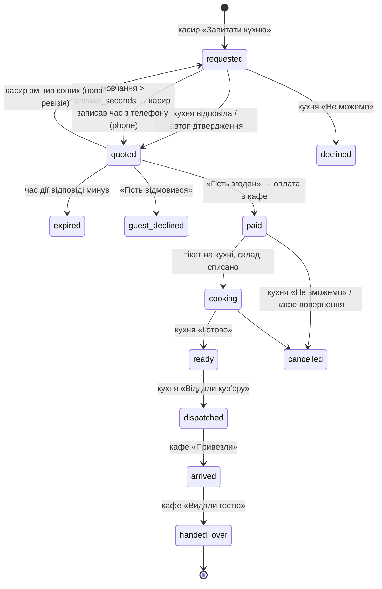

# Віддалена кухня: точка просить час, кухня підтверджує (модуль `remote-kitchen`)

Дизайн-док і **точка відновлення** треку РК (фази РК0–РК6, таблиця в §12). Макети UX
(`design/remote-kitchen/mockups.html`, приватні в експорті; опубліковано: https://claude.ai/artifact/FQCUqEd8AayEG92xAzdokM)
і рішення власника (§14) затверджено 2026-11-24. Гілка `feat/remote-kitchen-sync`, почато 2026-11-24 на `main`
`7125aca`, PR merenkoff/tiktok-live#465.

**Стан на 2026-11-25:** РК1–РК3 у коді — сервер, блок «З кухні» на касі кафе, смуга «Запити з точок» на касі
кухні, третій вид картки на дошці, тікет на принтері кухні. Клієнт — **окремий приватний модуль
`remote-kitchen`** (`pos/src/modules/remote-kitchen/`, порт 5014), а не частина `vertical-cafe`: так вирішив
власник у §14, і так виправлено 2026-11-25 після перевірки архітектури (§15). Що ще не зроблено — §12.

## 1. Запит власника (2026-11-24)

Клієнт — мережа «Пульчинелла» в Малині (піца, суші та роли, бургери, wok). Три точки (дані з сайту міськради,
див. §13): основна кухня з доставкою на вул. Степана Бандери, 11 (далі **кухня**, у запиті — «дарк-кітчен»),
**Pulcinella Park** у центральному парку, вул. Паркова, 3 (далі **точка** або **кафе**) і кав'ярня на
Грушевського, 22 (у цей трек не входить).

Як працює зараз (зі слів власника):

1. Кафе в парку продає лише з каси, без модуля столів. Хот-доги, нагетси, картоплю фрі готують на місці;
   замовлення приймають у Poster.
2. Піцу й суші кафе не готує. Касир **дзвонить на кухню** й питає, скільки чекати.
3. Гість погоджується — касир пробиває продаж, кухня готує, кур'єр везе в парк.

Що просить власник: частина товарів має позначку «готується в іншому місці». Коли касир набирає такий
товар, це схоже на новий раунд на кухню, але віддалену, і **не одразу**: спершу кухня має сказати, скільки
готувати. Два боки модуля: зручний запит часу на касі кафе і оцінка часу на боці кухні. Механіка має бути
автоматизована. Плюс доставка — заготовка під майбутній модуль доставки. На обох точках стоїть наша програма.

## 2. Теза

Дзвінок замінюємо **запитом із таймером**, а не новим каналом зв'язку. Касир не пише нічого руками: він набирає
піцу так само, як хот-дог, і натискає «Запитати кухню». Кухня бачить картку з уже порахованою пропозицією
(«25 хв: піца 18 + дорога 7») і відповідає одним тапом. Якщо кухня вмикає автопідтвердження, у звичайну
годину ніхто не тапає взагалі: сервер відповідає сам за секунду.

Три правила, на яких тримається все інше:

- **Нічого не готується й не списується, поки гість не погодився й не заплатив.** Це те саме правило, що в
  запитах гостя з QR-меню (Q6, `POS_QR_MENU.md`): запит живе в окремих таблицях, а не в продажу чи раунді.
- **Відповідь кухні — це обіцянка з терміном дії.** Час, названий о 19:05, гість приймає до 19:08. Після цього
  запит треба оновити одним тапом, бо черга на кухні вже інша.
- **Телефон лишається запасним виходом, а не помилкою.** Немає мережі або кухня мовчить — каса сама показує
  номер кухні й дає записати названий по телефону час, щоб замовлення все одно потрапило в облік.

## 3. Що вже є в коді й на що спираємось

| Що | Де | Як використовуємо |
|---|---|---|
| Окремі таблиці для запиту, який ще не продаж; приймання однією транзакцією; ідемпотентність за `client_uuid`; час життя запиту | `pos_guest_orders` (міграція 058), `src/pos/guest-orders.service.ts`, `POS_QR_MENU.md` Q6–Q9 | Та сама форма для `pos_remote_orders`: запит → відповідь → приймання. Ті самі ліміти й «одна 404» |
| Раунд, що списує склад у момент відправки на кухню, зі знімком складників | `fireRoundTx`, `pos_bill_item_components`, `POS_TABLES.md` | Кухня списує інгредієнти, коли оплачене замовлення переходить у «Готується». Знімок — для скасування |
| Дошка кухні з двома тапами «Готово» / «Видано», поллінг 5 с, станції за теґом | `src/pos/kitchen.service.ts` `listOpenOrders`, `vertical-cafe/kitchen/*` | Замовлення точки — **третє джерело** дошки поруч із продажами за стійкою й раундами столів |
| Черга друку тікетів на станції з орендою 2 хв | `pos_round_prints`, `GET /kitchen/print-queue` (міграції 109–110) | Тікет замовлення точки друкується на принтері кухні тим самим механізмом |
| Онлайн-модуль, якого немає в shell, підписаний і з CDN | модулі `pass`, `tables` (`pos/src/modules/pass/manifest.ts`) | `remote-kitchen` постачається так само: без офлайн-хуків, кожен запис «Потрібна мережа» |
| Передзамовлення з `fulfilment` `pickup` / `delivery` і адресою | `pos_preorders`, `src/pos/preorders.service.ts` | Та сама пара значень у замовленні точки — шов під модуль доставки (§10) |
| Номер замовлення на пів екрана | екран успіху кафе, `order_no` | Номер замовлення точки «П-12» на талоні гостя, на дошці кухні й на тікеті |

Чого в коді **немає**: жодного зв'язку між двома магазинами (`pos_stores`). Кожен магазин — окремий тенант зі
своїм входом, складом і ПРРО. Зв'язка магазинів — нова сутність цього треку (§5.1).

## 4. Де живуть дві каси: дві крамниці, зв'язані між собою

Рекомендую **два окремі магазини** на одному бекенді (`the-live.shop`) і нову зв'язку між ними:

- кафе — магазин вертикалі `cafe` зі своєю касою, ПРРО, складом хот-догів і персоналом;
- кухня — магазин вертикалі `cafe` (дошка, техкарти, склад інгредієнтів), який, найімовірніше, продає ще й
  свою доставку додому через свою касу.

Чому не одна крамниця з «віддаленою станцією»:

| | Дві крамниці + зв'язка (рекомендую) | Одна крамниця, кухня — станція |
|---|---|---|
| Склад | У кожної точки свій. Борошно на кухні, сосиски в парку | Один склад на дві адреси: інвентаризація плутає, що де лежить |
| ПРРО | Кожна точка — свій ПРРО і своя зміна. Два касири працюють одночасно | Одна фіскальна конфігурація на дві адреси й два касира |
| Звіти | Виторг парку окремо, виторг кухні окремо | Усе змішано, треба фільтр «точка», якого немає |
| Код | Нова зв'язка + міжмагазинні запити (≈ так само, як гостьові запити між гостем і столом) | Здається простіше, але «точка» всередині магазину — це зміна ядра (склад, ПРРО, персонал, звіти) |
| Масштаб | Третя точка (кав'ярня) або друга кухня — ще одна зв'язка | Тупик на двох адресах |

Рішення власника (§14, П5): **дві крамниці, два склади**. Спільна адмінка для кількох точок одного власника —
у плані («Далі» в §12), не в цьому треку.

## 5. Модель даних (міграція `117`)

Джерело правди — сама міграція `migrations/117_pos_remote_kitchen.sql`; тут — що в ній і навіщо. Ідентифікатори
магазинів і персоналу — `BIGINT`, бо `pos_stores.id` і `pos_staff.id` — `BIGSERIAL` (002).

### 5.1 Зв'язка точки з кухнею

- **`pos_kitchen_links`** — хто в кого може просити: `cafe_store_id`, `kitchen_store_id` (різні, пара унікальна),
  `status` `active` | `paused` | `revoked` (не видаляємо: на зв'язку посилаються замовлення), `kitchen_title`
  («Кухня Пульчинелли» — так касир бачить кухню), `kitchen_phone` (запасний вихід, §8), `transit_minutes`
  (0–240, 10), `answer_seconds` (15–600, 60), `quote_ttl_seconds` (30–1800, 180), `auto_confirm_max_min`
  (5–240 або NULL = вимкнено, 40). Межі — `CHECK pos_kitchen_links_numbers`.
- **`pos_kitchen_link_items`** — яка страва кафе якою стравою кухні є: `(link_id, cafe_variant_id)` →
  `kitchen_variant_id`. Наявність рядка і є позначка «готується на кухні».

Чому окремий варіант у кафе, а не «чужий» товар кухні в каталозі кафе: ціну в парку ставить кафе (вона може
відрізнятися від ціни доставки), а фіскальний рядок чека — це товар кафе з його ПРРО. Кухні треба знати
**що готувати** (`kitchen_variant_id` → її техкарта), кафе — **що продавати**. Картка кафе для страви кухні
— звичайний `simple`-товар; склад кафе за неї не рухається (§9), але каса сірить плитку з нулем на складі,
тож такій картці потрібен залишок «без обліку», як корковому збору (сід `POS_SEED_REMOTE_KITCHEN` ставить
100 000). **«Імпорт меню кухні»** (РК4, `POST /remote-kitchen/link/import`, власник кафе) робить таку картку для
кожної обраної страви кухні — «Маргарита» або «Маргарита (32 см)», з ціною, яку власник кафе вводить сам (ціна
кухні з кухні не виходить), і залишком `KITCHEN_DISH_STOCK` — і одразу пише рядок у цю таблицю. Картку кафе з
такою самою назвою імпорт бере замість нової, уже позначену страву пропускає: повторний імпорт нічого не
змінює. Окрему позначку на наявну картку й далі ставить `PUT /remote-kitchen/link/items/:variantId`.

### 5.2 Що кухня каже про себе зараз

**`pos_kitchen_status`** — `accepting` («Пауза прийому»), `paused_until` (пауза знімається сама, рахується при
читанні), `load_minutes` («черга зараз», 0–180). Час приготування страви — той самий `pos_products.prep_minutes`
кухні, який гість бачить у QR-меню (F14); другого стовпця немає.

### 5.3 Запит і замовлення точки

- **`pos_remote_orders`** — один запит від `client_uuid` каси кафе (повтор — той самий рядок, унікальний індекс
  `(cafe_store_id, client_uuid)`); `revision` (касир змінив кошик — нова ревізія, старий час недійсний);
  `status` (§6); `quote_source` `kitchen` | `auto` | `phone`; розклад часу `prep_minutes`, `load_minutes`,
  `transit_minutes`, `suggested_minutes` (підказка кухні) і `quoted_minutes` (обіцяне гостю); `promised_at`,
  `answer_deadline_at`, `quote_expires_at`; `decline_reason`; `order_no` («П-12», лічильник кухні на її день,
  дається при оплаті); `guest_label`, `note`; `cafe_sale_id` (один чек оплачує не більше одного запиту —
  унікальний частковий індекс); шов доставки `fulfilment`, `delivery_address`, `delivery_id` (§10); хто й коли:
  `requested_by`, `quoted_by`, `requested_at` … `closed_at`, `updated_at`. Стану «гість згоден, не заплатив»
  і стовпця `accepted_at` **немає** (§6).
- **`pos_remote_order_items`** — рядки: `cafe_variant_id`, `kitchen_variant_id`, `quantity`, `product_name` і
  `variant_label` (як їх бачив касир), `modifiers` (JSONB), `note`, `problem` (`stop` | `unavailable` — кухня
  відмітила «немає»), `sort_order`. До оплати `modifiers` — те, що прислала каса; **оплата переписує їх знімком
  відповідей самого чека** (назви й ціни, які розв'язав сервер), тож кухня готує те, за що заплачено.
- **`pos_remote_order_item_components`** — що одиниця оплаченого рядка взяла зі складу **кухні**, та сама
  арифметика, що в `pos_bill_item_components`: скасування повертає саме це, а не поточну техкарту.
- **`pos_remote_order_events`** — журнал «хто, коли, що» для розборів «чому піца їхала 50 хвилин».
- **`pos_remote_order_prints`** — тікети оплачених замовлень на принтері кухні, `(remote_order_id, kind)`,
  `kind` `fire` | `cancel`, оренда 2 хв (§7.2).
- **`pos_sale_items.remote_order_item_id`** (`ON DELETE SET NULL`) — рядок чека кафе, що оплатив страву кухні.
  Такий рядок не рухав склад кафе, не стоїть на дошці кафе й не друкується на її кухонному талоні (§9).

## 6. Стани



- `paid` і `cooking` — один крок на сервері: оплата в кафе в тій самій транзакції ставить одразу `cooking`,
  дає «П-N», списує склад кухні й ставить тікет у чергу друку. `paid` є в `CHECK` і в списках живих станів, але
  код його не ставить: склад продажем може піти в мінус (`applyStockDelta`, причина `sale`), тож «не вийшло
  списати» не буває.
- `accepted` («гість згоден, але ще не заплатив») навмисно **немає**: касир тисне «Гість згоден», і каса одразу
  відкриває оплату. Якщо оплата не вдалась, замовлення лишається `quoted` до кінця дії відповіді.
- Мовчання кухні довше за `answer_seconds` не міняє стану: запит лишається `requested` з `answer_overdue`, і
  лише тоді каса пропонує телефон (`phone-quote` раніше — 409 «Кухня ще може відповісти»). `expired` — це
  названий час, що минув.
- Пропуск і реверс станів — 409 словами кухні, повтор того ж стану — 200 (як `PATCH /sales/:id/prep`).
- **Змішаний кошик** (хот-дог + піца) — **один** продаж і один чек. Хот-дог іде на дошку й талон кухні парку,
  як зараз; піца стає замовленням точки. «Оплатити» не відкриває оплату, поки в кошику є рядок кухні без
  чинної відповіді й згоди гостя: модуль кладе причину в `useCartStore.setCheckoutHold('remote-kitchen', …)`,
  і каса показує її банером. Касир може прибрати рядки кухні або подзвонити й записати час, названий по
  телефону (продажу «за оцінкою» без кухні немає, П3).
- Касир змінив кошик після запиту (кількість, відповідь, нотатку) — каса одразу шле кухні нову ревізію
  (`PUT …/items`) і забирає згоду гостя. Страви кухні прибрали з неоплаченого кошика — запит закривається як
  «гість відмовився».

## 7. Автоматизація: хто що натискає

### 7.1 Пропозиція часу (рахує сервер)

```
prep    = MAX(prep_minutes страв кухні в запиті)      -- піца 18, сет 25 → 25
черга   = load_minutes кухні                           -- «+10» кухар ставить одним тапом
дорога  = transit_minutes зв'язки                      -- 10
час     = округлити вгору до 5 хв (prep + черга + дорога)
```

Кухар бачить не голе число, а розклад: «35 хв = сет 25 + черга 0 + дорога 10». Фаза РК4 замінює `prep` і
`черга` на виміряне: медіана «оплачено → Готово» цієї страви за 14 днів і кількість замовлень у «Готується»
зараз.

### 7.2 Відповідь кухні

| Режим | Що відбувається | Тапів на кухні |
|---|---|---|
| **Автопідтвердження** (`auto_confirm_max_min` = 40) | Кухня приймає, усі страви доступні, пропозиція ≤ 40 хв → сервер одразу відповідає `quote_source='auto'`. Кухар бачить сіру картку «Автопідтверджено 30 хв» і може протягом дії відповіді натиснути «Змінити час» | 0 |
| **Ручний** | Картка зі звуком, пропозиція вже вибрана, чипи 15 / 20 / 25 / 30 / 40 / 50, «Немає» біля кожної страви, «Не можемо» з причинами | 1 |
| **Пауза** | `accepting=false` → каса кафе бачить «Кухня на паузі» з телефоном у блоці «З кухні», плитки страв кухні сірі з підписом «пауза» (за ~35 с: плитки щопів хвилини перечитують налаштування, спільна відповідь для них не старша за 5 с) | — |

Що з цього в коді: автопідтвердження на сервері (`applyEstimate`); на кухні — смуга «Запити з точок» над
будь-яким екраном каси (§11) із сигналом і відліком до кінця часу на відповідь. У картці запиту (РК4, 2026-11-25)
пропозиція з власних чисел кухні вже вибрана, поруч чипи 15 / 20 / 25 / 30 / 40 / 50 (пропозиція, якої серед них
немає, стає ще одним чипом) і ±5 хв; «Немає» біля кожної страви — кнопка «Немає N страв — сказати кафе» шле
`decline` з `problems` (`unavailable`), і каса кафе показує, яких страв немає; «Не зможемо» з однією причиною.
Автопідтверджене замовлення стоїть у смузі сірою карткою «Автопідтверджено N хв» без сигналу, доки гість думає
(`quote_expires_at`): «Змінити час» відкриває ті самі чипи, і кухня один раз переписує час (`quote` з
`quoted`/`auto` → `quote_source='kitchen'`, подія `requoted`; другий раз — 409). Каса кафе тоді забирає «Гість
згоден» і питає гостя знову з новим часом. Паузу й чергу кухня ставить на сторінці «Точки» і на «Прийомі
запитів» своєї каси (`PUT /remote-kitchen/status`, §11). На касі кафе пауза кухні — рядок «Кухня на паузі» з телефоном у блоці «З кухні»; сірих
плиток немає (§12).

**Тікет.** Оплата в касі кафе ставить у чергу кухні один тікет (`pos_remote_order_prints`, міграція 117, `remote-kitchen-print.service.ts`). Десктоп кухні забирає його разом із тікетами столів (`GET /remote-kitchen/print-queue`, оренда 2 хв, старше 12 год не друкується), друкує на кухонному принтері «П-12 · Pulcinella Парк · Стіл 3 · до 18:40» без цін і підтверджує (`POST …/:orderId/printed`). Скасоване до друку не друкується зовсім; скасоване після — друкує «СКАСОВАНО». Чергу питає лише десктоп магазину, який вхід назвав кухнею (`store.remote_kitchen`, «є жива зв'язка, де цей магазин — кухня»): інакше кожен десктоп із кухонним принтером у кожному магазині питав би порожню чергу кожні 5 с. Сервер без цієї черги (404) десктоп не питає 10 хв і друкує столи як раніше.

### 7.3 Таймери

| Таймер | За замовчуванням | Що після |
|---|---|---|
| Відповідь кухні | 60 с (`answer_seconds`) | запит лишається `requested` з `answer_overdue` → каса показує «Кухня не відповідає», номер телефону й «Записати час з телефону» |
| Дія відповіді (гість думає) | 3 хв | `expired` → «Запитати знову» одним тапом (нова відповідь, може бути інший час) |
| Обіцянка | `promised_at` | Кухня рахує від `cook_by` = обіцянка мінус дорога: за 5 хв до нього картка на дошці жовтіє, після — червона з «Запізнюємось на N хв»; кухар тисне «+10 хв», і обіцянка зсувається в кафе теж |
| Невидане | 2 год після `arrived` | Нагадування на касі кафе, не автозакриття |

Закінчення таймерів рахує сервер при кожному читанні (як `expireStaleGuestOrders`) і під замком замовлення
перед оплатою (`lockOrder`), без крона: один інстанс (`POS_SINGLE_INSTANCE.md`) і поллінг роблять крон зайвим.

У коді — три перші таймери. «+10 хв» є і на картці дошки (обидві колонки, доки не «Віддали курʼєру»), і на
«Прийом запитів» каси кухні (РК5, §8.1). Дошка шле `POST /kitchen/remote-orders/:id/delay` — маршрут кухні поруч
із `…/prep`, бо дошка належить вертикалі кафе й маршрутів модуля не знає; той самий `delayOrder`, що й
`POST /remote-kitchen/orders/:id/delay`. `cook_by` дошці дає `GET /kitchen/orders?with=remote`; старий сервер без
нього — дошка рахує від `promised_at`. Нагадування про невидане — рядок трекера кафе «гість ще не забрав» (РК5,
§8.1). Замовлення, яке кухня так і не відмітила «Готово»/«Видано», кафе може закрити «Вже привезли» не раніше ніж
через 20 хв після обіцяного (`LATE_ARRIVAL_MINUTES`, §8.1).

## 8. Синхронізація між двома касами

**Транспорт — спільна база.** Обидва магазини на одному бекенді, тож «синхронізація» — це рядки
`pos_remote_orders`, які кафе пише, а кухня читає, і навпаки. Ні peer-to-peer, ні черг повідомлень.

| Хто | Що читає | Як часто |
|---|---|---|
| Каса кафе, коли в кошику вперше з'явилася страва | `GET /remote-kitchen/setup` | раз на сесію каси (після збою — не частіше ніж раз на хвилину) |
| Каса кафе, поки чекає відповіді | `GET /remote-kitchen/orders/:id` | 3 с |
| Каса кафе, поки діє названий час | `GET /remote-kitchen/orders/:id` | 10 с |
| Смуга кухні: чи цей магазин — кухня | `GET /remote-kitchen/setup` | раз при відкритті, далі раз на 10 хв, поки відповідь «ні» |
| Смуга кухні, коли магазин — кухня | `GET /remote-kitchen/orders?side=kitchen` (з `now` сервера) | 3 с, лише видима вкладка |
| Дошка кухні | `GET /kitchen/orders?with=remote` | 5 с |
| Десктоп кухні з кухонним принтером, якщо вхід каже `remote_kitchen` | `GET /remote-kitchen/print-queue` | 5 с |
| Трекер на касі кафе: чи цей магазин — кафе якоїсь кухні (зв'язка або `cafe_orders`) | `GET /remote-kitchen/setup` (одне читання на обидві смуги банера, `lib/sides.ts`, відповідь тримається 30 с і лише для того самого магазину) | раз при відкритті, далі раз на 10 хв, поки відповідь «ні» |
| Трекер на касі кафе, коли магазин — кафе | `GET /remote-kitchen/orders?side=cafe` | 10 с, лише видима вкладка |
| «Замовлення точок» на «Прийом запитів» кухні | `GET /remote-kitchen/orders?side=kitchen` | 10 с, лише видима вкладка |
| Слова на плитках страв кухні («кухня ≈30 хв», «пауза», «кухня вимкнена», «немає на кухні», «потрібна мережа») | `GET /remote-kitchen/setup` (те саме спільне читання, для плиток не старше 5 с; `items[].available` — страва жива й не на стопі кухні її днем) | 30 с, поки магазин — кафе якоїсь кухні, інакше раз на 10 хв, лише видима вкладка, один цикл; без мережі — одразу й без запиту, і на касі, що стартувала без мережі, — з того, що пристрій запам'ятав минулого разу |

У POS ніде немає WebSocket, усе — поллінг; лишаємось у цьому. Фаза РК4 може додати long-poll
`GET /remote-kitchen/orders?side=kitchen&wait=25` (сервер один, тож достатньо in-process `EventEmitter`), щоб звук на кухні
лунав за долю секунди, а не за три.

**Ендпоїнти (РК1, `src/pos/routes/remote-kitchen.routes.ts`).**

```
Обидві сторони (ensurePosAuth; сервіс перевіряє, з якого боку замовлення магазин сесії):
  GET    /remote-kitchen/setup                  {as_cafe: {link, kitchen, items} | null, as_kitchen: {status, cafes} | null,
                                                 cafe_orders: є оплачене в дорозі чи скасоване кухнею без відповіді —
                                                 і після відкликання зв'язки}
  GET    /remote-kitchen/orders?side=cafe|kitchen   {orders, now}: живі + змінені за останні 3 год; щонайбільше 200,
                                                 і коли їх більше, відкидаються найстаріші завершені, ніколи живі
  GET    /remote-kitchen/orders/:id             (лише своя зв'язка; чуже — одна 404)
  GET    /remote-kitchen/orders/:id/events      журнал
  POST   /remote-kitchen/orders/:id/cancel      {reason} — оплачене й ще не відправлене; кухні повертається списане
Кафе:
  POST   /remote-kitchen/orders                 {client_uuid, items[{variant_id, quantity, modifiers?, note?}], guest_label?, note?}
                                                201 новий / 200 той самий uuid
  PUT    /remote-kitchen/orders/:id/items       {revision, items} — нова ревізія кошика
  POST   /remote-kitchen/orders/:id/phone-quote {minutes} — лише коли час відповіді кухні минув (П3)
  POST   /remote-kitchen/orders/:id/guest-declined
  POST   /remote-kitchen/orders/:id/paid        {sale_id} — після звичайного POST /sales (П2), див. нижче
  POST   /remote-kitchen/orders/:id/arrived | /handed   «Привезли» — на ready/dispatched, а на paid/cooking лише через
                                                 20 хв після обіцяного (кухня забула відмітити)
  POST   /remote-kitchen/orders/:id/cancel-seen «Гостю повернули» — лише на скасоване кухнею (РК5, міграція 118)
Кухня:
  POST   /remote-kitchen/orders/:id/quote       {minutes, revision} — час до виходу з кухні; дорогу додає сервер
  POST   /remote-kitchen/orders/:id/decline     {reason?, problems?: [{item_id, problem}], revision?}
  POST   /remote-kitchen/orders/:id/ready | /dispatched
  POST   /remote-kitchen/orders/:id/delay       {minutes, reason?}
  PUT    /remote-kitchen/status                 {accepting, pause_minutes?, load_minutes?}
  GET    /remote-kitchen/print-queue            тікети оплачених замовлень (X-POS-Device-ID, оренда 2 хв)
  POST   /remote-kitchen/print-queue/:orderId/printed?kind=fire|cancel
Дошка кухні (core `kitchen.routes.ts`, розділ «Кухня» = `vertical-cafe`):
  GET    /kitchen/orders?with=remote            третій вид картки — лише дошці, що попросила
  PATCH  /kitchen/remote-orders/:id/prep        {prep_status: ready | served} — «Готово» / «Віддали курʼєру»;
  POST   /kitchen/remote-orders/:id/delay       {minutes} — «+10 хв» з дошки (той самий delayOrder);
                                                дошка ходить сюди, а не в маршрути модуля (§11)
Власник кафе (ensurePosOwner):
  PATCH  /remote-kitchen/link                   таймери, поріг, дорога, телефон, active/paused
  GET    /remote-kitchen/link/dishes            страви кухні (лише назви й час, без цін і залишків)
  GET    /remote-kitchen/link/items             (ensurePosAuth)
  PUT    /remote-kitchen/link/items/:variantId  {kitchen_variant_id} — позначка «готується на кухні»
  DELETE /remote-kitchen/link/items/:variantId
Власник будь-якого боку (ensurePosOwner, РК5):
  GET    /remote-kitchen/report?side=cafe|kitchen&days=1..90   (днів календаря магазину, 1 = сьогодні; інше — 400)
                                                {side, days, from, rows}: по кожній точці (`store_id`; для кафе —
                                                назва кухні зі зв'язки) оплачені за період: дійшли до кафе (кухня
                                                «Видано» АБО кафе «Привезли»/«Видали»), вчасно за ПЕРШОЮ обіцянкою
                                                й за перенесеною, переносили, скасовано (з них кухнею), собівартість
                                                за сьогоднішніми цінами закупівлі й рядки без ціни, страви з розміром
  GET    /remote-kitchen/report/sides           {sides}: на яких боках є звіт — усі зв'язки, відкликані теж
Супер-адмін (ensureSuper):
  POST   /super/remote-kitchen/links            {cafe_store_id, kitchen_store_id, kitchen_title, kitchen_phone?, transit_minutes?}
  PATCH  /super/remote-kitchen/links/:id        те саме, що власник, плюс revoked
```

**Оплата — тим самим чеком кафе, в одній транзакції (РК2).** Каса шле звичайний
`POST /sales/complete` з полем `remote_order_id`. `completeSale` під замком замовлення перевіряє, що воно
`quoted` і час ще діє, і зіставляє рядки кошика з рядками замовлення: той самий варіант, кількість **і
відповіді модифікаторів** (піца з сирними бортиками — не та, про яку питали кухню; `sameRemoteDish`). Такі
рядки отримують `remote_order_item_id`, **не** списують склад кафе, а рядок кухні отримує знімок відповідей
чека (`claimRemoteLineTx`); решта кошика (напої, десерти) продається як завжди. Якщо щось із замовлення в кошику бракує — 409 «Кошик не збігається із замовленням кухні», чек не
створюється. Потім у тій самій транзакції замовлення отримує номер кухні на її день, промінь «буде о …» і
списання зі складу **кухні** (`pos_remote_order_item_components`, ціль `remote` у `consumeStockForLine`).
Чек і «кухня готує» з'являються разом або не з'являються взагалі. Замовлення кухні оплачується одним
онлайн-чеком: розбиття на дві каси чи офлайн-чек із `remote_order_id` — 409.

`POST /remote-kitchen/orders/:id/paid {sale_id}` лишається для випадку, коли чек уже проведено окремо: та
сама перевірка (чек цього кафе, не анульований, зроблений, поки час ще діяв), повтор з тим самим чеком — те
саме замовлення, другий чек — 409.

Кожен запис перевіряє, що магазин сесії — **ця** сторона **цієї** зв'язки, і зв'язка `active`. Кухня ніколи не
бачить цін і чеків кафе, кафе — собівартості кухні.

**Офлайн.** Модуль онлайн-only, як `tables` і `pass`: запит часу без мережі не має сенсу, бо кухня його не
отримає. Що є зараз:

- без мережі страву кухні **не продати**: запит не йде, блок «З кухні» каже, що кухня не отримала запит, а
  «Оплатити» лишається притриманим. Касир прибирає страву з кошика або чекає мережі;
- чек із `remote_order_id` не стає в офлайн-чергу десктопа (`offline/repository.ts` відмовляє словами
  «Замовлення з кухні оплачується лише онлайн»), а чек, на який сервер не відповів, перевіряється тим самим
  ключем, а не пробивається вдруге: кухня, можливо, уже готує;
- сервер відмовляє офлайн-чеку (`fiscal_offline`) і розбиттю на дві каси з `remote_order_id` — 409.

План (не зроблено): плитки страв кухні з підписом «потрібна мережа»; тап — лист «Подзвоніть на кухню: 0XX…»
з полем «Кухня сказала: __ хв»; такий продаж іде звичайним офлайн-чеком «узгоджено телефоном», а після синку
сервер створює замовлення точки з `quote_source='phone'` одразу в `cooking`, без звуку й другого тікета.

**Self-hosted (дві інсталяції на різних серверах)** — поза треком. Шов лишається: зв'язка з полем
`kitchen_endpoint` і підписаними HTTPS-запитами між інсталяціями — окремий дизайн, коли з'явиться такий клієнт.

### 8.1 Трекер на касі кафе (РК5)

Друга половина `till.Banner` модуля (`till/TillBanner.tsx`): над кожним екраном каси кафе — «Замовлення з
кухні · N» (`tracker/CafeTracker.tsx`). Смуга кухні й трекер дізнаються, з якого боку магазин, з одного читання
`GET /remote-kitchen/setup` (`lib/sides.ts`; відповідь тримається 30 с і лише для того самого магазину, тож вхід
в інший магазин на тій самій касі питає знову); магазин, що не кафе жодної кухні, замовлень не опитує, а поки
нічого оплаченого не їде, трекер нічого не малює. Кафе — це зв'язка **або** `cafe_orders`: після того як
супер-адмін відкликав зв'язку, «З кухні» зникає, а те, що ще їде, і нерозв'язане скасування кухні лишаються на
касі, доки їх не закриють.

- **Рядок замовлення** — «П-12 · Стіл 3 · Маргарита 32 см», чотири кроки «Готується → Їде → Привезли → Видали»
  (`ready` — «Готово» на першому кроці), «буде до 18:40» і, якщо обіцяне минуло, «запізнюється на N хв»; якщо
  кухня тиснула «+N хв» (`delayed_minutes` — сума подій `delayed`), — «кухня додала N хв».
- **Тапи кафе** — лише коли черга за кафе: «Привезли» на `ready`/`dispatched`, «Видали гостю» на `arrived`. Поки
  кухня готує, кнопки немає: помилковий тап прибрав би картку з дошки кухні, коли піца ще в печі. Але якщо кухня
  так і не відмітила «Готово»/«Видано», а обіцяне минуло на 20 хв (`LATE_ARRIVAL_MINUTES`, сервер і каса), — кнопка
  «Вже привезли» з питанням «Кухня не відмітила… Його справді привезли?» (без `window.confirm`, який у десктопі
  нічого не робить): інакше рядок висів би над кожним екраном кафе назавжди. Сервер раніше відмовляє словами,
  `ready_at`/`dispatched_at` за кухню не пише, а в журнал іде `arrived` з `kitchen_unmarked`. Привезене, але
  невидане понад 2 год — «гість ще не забрав» (нагадування, не автозакриття, §7.3).
- **Скасовано кухнею** — червоний рядок «П-12 · Стіл 3 · чек ЧК-000123 — скасовано кухнею — поверніть гостю» з
  причиною, поки касир не натисне «Гостю повернули» (`POST …/cancel-seen`). Номер чека кафе
  (`cafe_receipt_number`, лише стороні кафе) — те, за чим касир знайде його в «Чеки»: «П-12» — номер дня кухні,
  у кафе його ніде немає. Гроші повертаються звичайним поверненням чека кафе; тап лише каже, що гостю сказали й
  повернули. Міграція 118 записує, хто скасував (`cancelled_by`: власне скасування кафе — анулювання чека чи
  «Скасувати» — новиною для кафе не є) і коли кафе відповіло (`cancel_seen_at`). `GET …/orders?side=cafe` віддає
  скасоване кухнею без відповіді до доби, навіть коли воно старше за звичні 3 год.
- **Опитування й тапи не сваряться.** Читання, що почалося до тапу, відкидається (`lib/writeGuard.ts`, як
  `writeSeqRef` у `useBill` модуля `tables`): інакше відповідь, яку сервер дав ДО тапу, повернула б на 10 с
  червоний рядок чи «Привезли» й підштовхнула б до другого тапу. Те саме — у смузі кухні й на «Прийом запитів».

**Що каже кухня.** На касі кухні «Прийом запитів» (`/remote-kitchen`, `kitchen/KitchenOrdersSection.tsx`) —
«Замовлення точок»: кожне оплачене замовлення, ще не віддане кур'єру (`paid`/`cooking`/`ready`), найближча
обіцянка першою, з «кафе обіцяно до 18:40» і двома кнопками — **«+10 хв»** (`POST …/delay`, один тап) і
**«Скасувати…»** з причиною (готові «Немає продуктів», «Зламалося обладнання», «Не встигаємо» або своя;
`POST …/cancel`). Саме ці два сигнали трекер показує касиру кафе («кухня додала 10 хв», червоний рядок), тож
дзвонити не треба. «Готово» й «Видано» лишаються на дошці кухні, де кухар їх уже тисне.

## 9. Гроші, чек і склад

- **Чек пробиває кафе, у момент «Гість згоден»** (як зараз: «пробивають, потім доставка»). Рядок чека — товар кафе
  за ціною кафе, ПРРО кафе. Кухня чека не робить.
- **Склад кухні** списується, коли замовлення переходить у `cooking` (одразу після оплати), зі знімком у
  `pos_remote_order_item_components` (ціль `remote` у `consumeStockForLine`). Склад кафе цей рядок не чіпає:
  `completeSaleTx` бачить, що рядок чека — страва кухні, і не викликає для нього `consumeStockForSaleItem`. У
  картки кафе свій залишок, який нікуди не рухається (§5.1).
- **Кухня не встигла / не змогла після оплати** (зламалась піч): будь-яка сторона скасовує оплачене й ще не
  відправлене замовлення з причиною (`POST …/cancel`), склад кухні **завжди** повертається зі знімку, а на
  принтері кухні виходить «СКАСОВАНО», якщо тікет уже друкувався. Гроші гостю кафе повертає звичайним
  поверненням чека: трекер каси кафе показує червоний рядок «П-12 · чек … — скасовано кухнею — поверніть гостю»,
  поки касир не відповість «Гостю повернули» (§8.1). Кухня скасовує на «Прийом запитів».
- **Розрахунок між точками** (кухня віддала піцу кафе): звіт «Віддано на точки» на кухні — кількість і
  собівартість по кожній зв'язці за день, 7 чи 30 днів календаря магазину. Собівартість — те, що замовлення
  забрало з полиці кухні (знімок `pos_remote_order_item_components`, інакше картка страви кухні), за
  СЬОГОДНІШНІМИ цінами закупівлі, як в аналітиці кафе; рядок без ціни не рахується як нуль, а названий окремо. Кафе й кухня — один ФОП (П1), тож документа передачі між ними немає:
  звіт внутрішній, для власника.
- **Анулювання чека кафе** (касир скасував, або ПРРО не прийняв чек — `abortSale` → `voidSale`): гість не
  заплатив, тож замовлення, що ще на кухні (`paid`, `cooking`, `ready`), скасовується з причиною «Чек кафе
  скасовано», і склад кухні повертається. Якщо піца вже їде — замовлення лишається, кухня бачить подію
  `cafe_sale_voided`. Склад кафе за рядки кухні не повертається, бо його й не списували.
- **Повернення за чеком кафе** (після фіскалізації) склад кафе за рядки кухні не чіпає й замовлення кухні не
  скасовує: піцу вже приготували. Якщо кухня має забрати її назад — це «Скасувати» на замовленні.
- Дошка кухні **кафе** не показує рядків, які готує віддалена кухня; чек лише з таких рядків на дошку не
  потрапляє. Кухонний талон кафе їх теж не друкує (`buildKitchenTickets` пропускає рядок із
  `remote_order_item_id`, який для цього віддає `GET /sales/:id`): піцу пече кухня й друкує її тікет на своєму
  принтері, а на принтері парку вона відправила б кухаря хот-догів пекти піцу.
- Оплата **після** отримання піци (гість платить, коли привезли) технічно можлива через `pos_preorders`, але
  тоді кухня готує те, за що ще не заплатили. Рекомендую лишити, як зараз: оплата одразу.

## 10. Шов під модуль доставки

Сьогодні «доставка» — це кур'єр, який везе піцу з кухні в парк. Цей трек фіксує лише мінімум:

- `fulfilment = 'to_store'` (везти на точку, що замовила) — єдине значення, яке вмикаємо;
- два тапи: кухня «Віддали кур'єру» (`dispatched_at`), кафе «Привезли» (`arrived_at`);
- `fulfilment = 'delivery'` + `delivery_address` + `delivery_id` вже в схемі, але запит їх не приймає: кожне
  замовлення — `to_store`.

Майбутній модуль `delivery` додає `pos_deliveries` (кур'єр, адреса, стани «призначено → у дорозі → доставлено»,
кілька замовлень в одній поїздці) і стає власником `dispatched/arrived`. Замовлення точки отримає `delivery_id`,
а дві кнопки цього треку стануть кнопками доставки. Сюди ж ляжуть власні замовлення кухні на доставку додому,
щоб кур'єр бачив одну чергу: і парк, і квартири.

## 11. Модуль, увімкнення й межі

- **Окремий приватний онлайн-модуль `remote-kitchen`** (`pos/src/modules/remote-kitchen/`, `private-modules.json`,
  `vite.remote-kitchen-remote.config.ts`, `build:`/`serve:`/`check:remote-kitchen-css-coverage`, порт 5014), як
  `pass` і `tables`: коду в shell немає, підписаний бандл із каналу релізів, `shells: ['web','cashier','tablet']`,
  `alwaysEnabled`, без офлайн-хуків. Не частина `vertical-cafe`: віддалена кухня потрібна не кожному кафе, а
  лише тому, що продає страви іншої кухні. З модулем окремо магазин вмикає й вимикає функцію через
  `module_remotes`, власник закриває її продавцю розділом «Доступ», вона має свій тариф і свій реліз — і
  жодне інше кафе не завантажує її коду й не опитує її маршрутів.
- **Увімкнення.** Обидва магазини отримують запис `remote-kitchen` у `module_remotes` (об'єкт з `routePath`
  `/remote-kitchen` і пунктом меню — вони формують лише заглушку десктопа, поки бандл не завантажено, як у
  `vertical-grocery`: на касі своєї сторінки модуль не має, лише сторінку в кабінеті власника). Сервер не пускає `remote-kitchen` без `vertical-cafe`
  (`MODULE_REQUIRES`, 400 з `PATCH /store` і в супер-адміна): дошка кухні й каса кафе — сторінки вертикалі.
  Маршрути — core-група без `enabled_modules`, як у `tables`/`pass`; ворота — сама **зв'язка**: магазин без
  неї отримує 404 на кожен запит, призупинена зв'язка — 409 з телефоном кухні, відкликана — як немає.
  `createLink` з'єднує лише два заклади з кухнею (`vertical.kitchen`).
- **Зв'язку створює супер-адмін** — блок «Віддалена кухня» в картці магазину супер-адмінки (лише для кафе):
  список зв'язок обох напрямків (`GET /super/remote-kitchen/links?store_id=`), «Зв'язати» з іншим кафе-магазином
  як кухнею чи точкою (`POST /super/remote-kitchen/links`), «Призупинити», «Відновити», «Відкликати» з
  підтвердженням (`PATCH`). Відкликану пару відновлює повторне «Зв'язати». Модуль у «Онлайн-модулях» обох
  магазинів вмикається окремо. Запрошення кодом між власниками — пізніше, коли з'явиться клієнт, у якого кафе й кухня
  належать різним людям.
- **Сторінка модуля в кабінеті власника** — `/admin/remote-kitchen` («Віддалена кухня», `ChefHat`), РК4. Що
  малювати, вирішує `GET /remote-kitchen/setup`: кафе бачить **«Кухня»** — назву й телефон кухні, час
  відповіді (60 с), дорогу (10 хв), скільки діє названий час (3 хв), автопідтвердження з порогом (40 хв) або
  без нього (`PATCH /remote-kitchen/link`), страви, які готує кухня, з «Прибрати», й «Імпорт меню кухні»;
  кухня бачить **«Точки»** — «Пауза 15/30/60 хв», «Пауза до відновлення», «Відновити прийом», «Черга зараз»
  (`PUT /remote-kitchen/status`) і свої кафе зі стравами кожного (`GET /remote-kitchen/kitchen/cafes`: назви й
  час кухні, без цін кафе). Магазин без зв'язки бачить, що зв'язку створює адміністратор. Імпорт пропонує й
  бере лише страви меню кухні (`sellable`, не приховані з меню): інгредієнт чи заготовка — 400 словами. Картка
  кафе з тією самою назвою береться, лише якщо вона продажна й проста; її залишок доводиться до
  `KITCHEN_DISH_STOCK`, а її ціна лишається й повертається в `kept_prices`, щоб сторінка сказала про це. Увесь
  імпорт — одна транзакція, і він скидає кеш гостьового меню.
- **«Прийом запитів» на касі кухні** — `/remote-kitchen` (пункт меню каси лише там, де вхід каже
  `store.remote_kitchen`): «Замовлення точок» з «+10 хв» і «Скасувати…» (РК5, §8.1) і ті самі «Пауза» й «Черга
  зараз», що на «Точках», для кухаря, який входить за PIN і в кабінет власника не потрапляє. Статус сторінка
  перечитує в мить, коли пауза минає.
- **Стіл не продає страву кухні.** Рахунок столу (і запит гостя з QR-меню, що стає рядком рахунку) відмовляє
  страві, позначеній «готується на кухні», словами «продайте на касі через «З кухні»» (`assertNotRemoteDish`
  у `bills.service.ts`): раунд пішов би на кухню КАФЕ, а віддалена кухня про піцу не дізналась би.
- **Розділ «Доступ».** `remote-kitchen` — свій розділ у `SECTION_ROUTES`: закритий продавцю, він закриває запит,
  ревізію, телефон, кроки замовлення, відповідь і паузу кухні (403 `section_closed`). Відкритими лишаються
  `GET /remote-kitchen/setup` (сам по собі нічого не малює), черга друку (друкує під тим, хто на десктопі) і
  чек — продаж нікому не закривається. Тапи картки на дошці — розділ «Кухня» (`vertical-cafe`).
- Тариф: модуль платний **для точки** (вона отримує зручність), кухня отримує його в парі. Ціну вирішує власник
  продукту, у коді лише прапорець.

### Де код у клієнті

- **Каса кафе — `checkout.Action` модуля** (`remote-kitchen/checkout/KitchenCheckoutAction.tsx`), над
  «Оплатити», як «Під запис» у `debts`. Хост дав кошику (платформа **25**) `remoteOrderId` / `setRemoteOrderId` —
  замовлення, на час якого гість погодився (`pay()` шле його як `remote_order_id`), — і причини притримати
  оплату **окремо для кожного модуля**: `checkoutHolds`, `setCheckoutHold(moduleId, reason | null)`. Модуль
  знімає лише свою причину й ніколи чужу. Розмову з кухнею веде один стор на касу (`checkout/store.ts`): на
  телефоні кошик намальовано двічі, і дві копії блоку не мають питати кухню двічі. Хост старший за 25 блоку не
  малює (`remoteCartControls()` повертає null) — каса продає, як до віддаленої кухні.
- **Каса кухні — `till.Banner` модуля** (`remote-kitchen/kitchen/RequestsStrip.tsx`): нове гніздо платформи 25,
  смуга над кожним екраном каси, яку малює рамка хоста (`CashierLayout`, `POS_MODULE_SLOTS.md`). Так «Запити з
  точок» стоять над дошкою, а дошка — сторінка `vertical-cafe` — нічого про модуль не знає: модуль, що
  вбудовується в чужий модуль, у нас навмисно не буває. Смуга спершу питає `GET /remote-kitchen/setup`, чи цей
  магазин — кухня, і лише тоді опитує запити; поки нічого не чекає, вона нічого не малює.
- **Дошка кухні — `vertical-cafe`, на рівні даних.** Замовлення точки — третій `kind` у `listOpenOrders`
  (картка з шапкою «П-12», під нею «Парк · до 19:40»), так само як раунд столу. Сервер віддає цей `kind` лише
  дошці, що попросила (`?with=remote`): стара дошка послала б тап на `/sales/:id/prep`, де той самий номер —
  чийсь чек. Тапи — `PATCH /kitchen/remote-orders/:id/prep` (core-маршрут кухні), а не маршрути модуля.
- **Друк — хост.** Тікет кухні друкує хостова черга десктопа (`offline/kitchenQueue.ts`, `remoteTicketOf`), як
  тікети раундів: бандл модуля працює лише поки змонтований, а друк мусить іти у фоні. Черга питає сервер лише
  в магазині-кухні (`store.remote_kitchen` у відповіді входу й `/me`). Кухонний талон кафе пропускає страви
  кухні (§9).
- **Межі, які тримають тести.** `check:private-imports`, правило 3: один ремоут-модуль не імпортує інший —
  спільне живе в бібліотеці (`fiscal-core`) або в хості (так `pass` отримав власні копії `usePolling`/`uuid`
  замість імпорту з `tables`). `vertical-cafe/manifest.test.ts`: вертикаль кафе не заповнює гнізд модуля й не
  звертається до `/remote-kitchen/`. `remote-kitchen/manifest.test.ts`: свій id, не вертикаль, не вбудований,
  два гнізда, без офлайну. `e2e/remote-kitchen.spec.ts`: справжні підписані бандли — запит, згода, оплата з
  `remote_order_id`; смуга над дошкою й відповідь одним тапом; кафе без модуля не робить жодного запиту до
  `/remote-kitchen/`.

## 12. Фази

| Фаза | Що | Стан |
|---|---|---|
| РК0 | Цей документ, макети UX, меню-зразок, рішення власника §14 | затверджено 2026-11-24 |
| РК1 | Міграція 117, `remote-kitchen.service.ts` (стани, таймери, пропозиція часу, автопідтвердження, оплата → списання на кухні), маршрути, тести; зв'язку створює супер-адмін через API | зроблено 2026-11-24 |
| РК2 | Каса кафе: блок «З кухні», запит, очікування, відповідь, телефон після тиші кухні, «Гість згоден» → оплата тим самим чеком; анулювання чека скасовує замовлення; офлайн — відмова | зроблено 2026-11-24/25; звірка рядків із модифікаторами й знімок відповідей чека — 2026-11-25. Позначки на плитках — у РК5 |
| РК3 | Кухня: запити зі звуком, відповідь одним тапом, замовлення на дошці, тікет на принтері кухні, «Віддали кур'єру» | зроблено 2026-11-24/25: смуга «Запити з точок» (±5 хв, «Не зможемо»), третій `kind` на дошці, черга друку з «СКАСОВАНО». Чипи часу, «Немає» біля страви й сіра картка автопідтвердження — у РК4 |
| РК3-а | Перевірка архітектури (§15): окремий модуль `remote-kitchen`, гніздо `till.Banner`, причини притримання по модулях, розділ «Доступ», `MODULE_REQUIRES`, `store.remote_kitchen`, маршрут дошки, правило 3 `check:private-imports`, сторожі демо-міграцій і `design/` в експорті | зроблено 2026-11-25 |
| РК4 | Автоматика й налаштування: сторінки «Кухня» (кафе) і «Точки» (кухня) з таймерами й позначками страв, «Імпорт меню кухні», пауза й черга для кухні, сіра картка автопідтвердження, «+10 хв» і червона картка, виміряний час страв, long-poll; кнопка зв'язки на `/super/stores/:id` | **РК4-мінімум** зроблено 2026-11-25: блок зв'язки в картці магазину супер-адмінки, сторінки «Кухня» й «Точки», «Імпорт меню кухні» (§11). **Автоматика кухні** зроблено 2026-11-25: чипи часу, «Немає» біля страви, сіра картка зі «Змінити час», «+10 хв» і червона картка на дошці (§7.2, §7.3); «+10 хв» є й на «Прийом запитів» разом із трекером (РК5). Виміряного часу страв і long-poll — ще ні; пауза й черга для кухні є з РК4-мінімуму (§11) |
| РК5 | Трекер на касі кафе («Готується → Їде → Привезли → Видали», «скасовано кухнею — поверніть гостю»), позначки на плитках, офлайн-продаж «узгоджено телефоном», талон гостю з номером і часом, звіт «Віддано на точки», % дотриманих обіцянок | **Трекер** зроблено 2026-11-25 (§8.1, міграція 118): рядки замовлень, «Привезли» / «Вже привезли» через 20 хв після обіцяного, «Видали гостю», червоне скасування кухні з номером чека кафе й «Гостю повернули», `cafe_orders` після відкликання зв'язки; на касі кухні «Замовлення точок» з «+10 хв» і «Скасувати…». **Позначки на плитках** зроблено 2026-11-25: страва кухні каже «кухня ≈30 хв» (її час, черга кухні й дорога, вгору до 5 хв, як рахує сервер) або «готує кухня», коли часу немає; «пауза», «кухня вимкнена», «немає на кухні» (страва на стопі кухні її днем або знята) і «потрібна мережа» роблять плитку сірою — коли заблоковано всі її розміри; заблокований розмір поруч із тим, що продається, просто не пропонується, і скан так само відмовляє словами плитки. Модуль кладе слова в `useCartStore.setTileMarks` (платформа 25), каталог `vertical-cafe` їх малює (`POS_MODULE_SLOTS.md`). Сервер не продає страву кухні без її замовлення: рядок, чий варіант у не відкликаній зв'язці, без `remote_order_id` — 409 словами («…готує віддалена кухня — спершу запитайте кухню»), крім офлайн-відтворення, рахунку столу, боргу й передзамовлення. **Звіт** зроблено 2026-11-25: на сторінці «Віддалена кухня» в кабінеті — «Віддано на точки» (кухня) і «Отримано з кухні» (кафе), і після відкликання зв'язки теж (`GET …/report/sides`); за сьогодні, 7 чи 30 днів календаря магазину по кожній точці: скільки дійшло до кафе (кухня натиснула «Видано» або кафе — «Привезли»/«Видали гостю»), скільки вчасно за ПЕРШОЮ обіцянкою — часом, який сказали гостю (привезли — або відправили плюс дорога — не пізніше), і який це відсоток, скільки переносили й скільки встигли з переносом, скільки скасовано і скільки з них — кухнею, собівартість за сьогоднішніми цінами закупівлі (рядки без ціни названі окремо), які страви якого розміру й скільки; дві точки з однією назвою розрізняє адреса. Офлайн-продажу, талона гостю — ні |
| РК6 | Слова: посібник, сайт, FAQ | — |
| Далі | Модуль `delivery` (§10); спільна адмінка для кількох крамниць одного власника (П5) | план |

**Порядок викладки** (коли дійде до релізу): API з міграціями 117 і 118 → POS Release (платформа 25: гніздо
`till.Banner`, причини притримання, `remoteOrderId`, друк тікетів кухні, талон кафе без страв кухні) → Module
Release `remote-kitchen` і `vertical-cafe` (дошка з третім видом і маршрутом `/kitchen/remote-orders`) →
зв'язка в супер-адміна (блок «Віддалена кухня» в картці магазину) → записи `remote-kitchen` у `module_remotes` лише двох магазинів «Пульчинелли» після
того, як їхні каси оновилися до 25 → «Імпорт меню кухні» на сторінці кафе (сторінка — частина модуля, тож лише
після його запису в `module_remotes`). Модуль, зібраний з `main` після підняття, вимагає `minHostPlatform` 25, тож
каса 24 його просто не завантажить. Локально: `POS_SEED_VERTICAL_CAFE=1 POS_SEED_REMOTE_KITCHEN=1 npm run
pos:seed` — `demo-cafe` питає `demo-suncity`, бандл на :5014 (`npm run build:remote-kitchen-remote && npm run
serve:remote-kitchen-remote`).

Кожна фаза — окремий план і PR, як у треках ДК і «Роздача».

## 13. Меню-зразок «Пульчинелли» (дані для макетів і тестових фікстур)

Повного меню з цінами знайти не вдалося: Instagram (@pizzeria_pulcinella_malin), Facebook і TikTok закривають
автоматичне читання, сайту, QR-меню чи сторінки в Glovo / Bolt Food немає. Знайдено ≈ 20 реальних назв у
місцевій пресі; ціни — лише дві, і обидві 2022 року. **Ціни в макетах — умовні**, позначені «приклад».

| Категорія | Назва | Ціна, джерело | Де готують |
|---|---|---|---|
| Піца | «Пульчінелла» (сири, прошуто, рукола) | — · infomalin.biz, 2020 | кухня |
| Піца | «4 сири» | — · infomalin.biz, 2020 | кухня |
| Піца | «4 м'яса» | — · infomalin.biz, 2020 | кухня |
| Піца | «Панчетта» | — · malyn.media, 2022 | кухня |
| Піца | «Копчена грудинка з цибулею» | — · malyn.media, 2022 | кухня |
| Піца | з телятиною (точна назва невідома) | — · malyn.media, 2022 | кухня |
| Роли | «Філадельфія» зі свіжим лососем | 115 грн (2022) · malyn.media | кухня |
| Роли | «Лосось креветка» | — · malyn.media, 2022 | кухня |
| Роли | «Мідорі» | — · malyn.media, 2022 | кухня |
| Роли | «Хоку» | — · malyn.media, 2022 | кухня |
| Сети | «Преміум» (Лосось креветка, Мідорі, Хоку) | — · malyn.media, 2022 | кухня |
| Сети | «Пульчінелла» | — · infomalin.biz, 2020 | кухня |
| Закуски | «Фрі-бокс» (нагетси, стріпси, цибулеві кільця, сирні палички, сирні трикутники, соуси), ≈1 кг | 350 грн (2022) · malyn.media | кухня |
| Парк | Хот-дог, нагетси, картопля фрі | — · зі слів власника | на місці |

Категорії меню мережі (сайт міськради): піца, суші та роли, бургери, wok, салати, закуски, авторські страви.
Instagram у пошуковій видачі: «піца • суші • бургери • салати • wok • bowl».

Точки мережі (malyn-rada.gov.ua, «Смаки громади»): Pulcinella — вул. Степана Бандери, 11 (виробництво й
доставка); Pulcinella Park — вул. Паркова, 3; Pulcinella Cafee — вул. Грушевського, 22. Міськрада називає
Pulcinella Park «кафе з повноцінною кухнею» — це розходиться з описом власника (піцу й суші везуть з кухні);
варто уточнити, що саме готують у парку.

Найкоротший шлях до справжнього меню з цінами й вагою — експорт меню з Poster від клієнта (він же дасть їхні
категорії й артикули для імпорту) або відкрити їхній Instagram у браузері власника.

## 14. Рішення власника (затверджено 2026-11-24)

| # | Питання | Рішення |
|---|---|---|
| П1 | Один ФОП чи різні? | **Один ФОП.** Документа передачі між кафе й кухнею немає; «Віддано на точки» — внутрішній звіт за собівартістю |
| П2 | Коли платить гість? | **Одразу після згоди.** Кухня не готує неоплачене |
| П3 | Кухня мовчить? | **Лише телефон** і «Записати час з телефону». Час очікування (60 с) налаштовується в адмінці. Продажу за автооцінкою немає |
| П4 | Автопідтвердження? | **Так, як фіча.** Поріг за замовчуванням 40 хв, міняється в адмінці, можна вимкнути |
| П5 | Дві крамниці чи одна? | **Дві крамниці, два склади.** Спільна адмінка — план на потім |
| П6 | Дорога | **Фіксована** в зв'язці (10 хв) |
| — | Форма постачання | **Окремий онлайн-модуль** `remote-kitchen` (§11) |

## 15. Перевірка архітектури 2026-11-25

Перший варіант клієнта зробили всередині `vertical-cafe`: блок «З кухні» був `checkout.Action` вертикалі, а
панель запитів — частиною дошки. Це суперечило рішенню §14 і канону модулів (рішення власника 2026-10-24:
функції й інтеграції — зовнішні модулі, хост і сервер отримують лише те, що модуль не може нести). Наслідки, які
виправлено:

| Було | Наслідок | Тепер | Хто стереже |
|---|---|---|---|
| Код у `vertical-cafe` | кожне кафе його завантажувало; дошка будь-якої кухні опитувала `?side=kitchen` кожні 3 с; не ввімкнути для одного магазину, не закрити продавцю, не продати окремо | модуль `remote-kitchen`; смуга опитує лише кухню | `check:private-imports` (правило 3), `vertical-cafe/manifest.test.ts`, `e2e/remote-kitchen.spec.ts` |
| Панель вшита в `OrdersTab` | модуль усередині чужого модуля | гніздо хоста `till.Banner` | `CashierLayout.test.tsx`, `featureSlots.test.ts` |
| Дошка тапала `/remote-kitchen/orders/:id/ready` | вертикаль знала маршрути модуля | `PATCH /kitchen/remote-orders/:id/prep` | `kitchenApi.test.ts`, `pos.remote-kitchen.test.ts` |
| Одна строка `checkoutHold` | модуль, що знімав свою причину, знімав і чужу | `checkoutHolds` по модулях | `useCart.holds.test.ts`, `KitchenCheckoutAction.test.tsx` |
| Талон кафе друкував усі рядки | піца виходила на принтері кухаря хот-догів | рядок із `remote_order_item_id` пропущено | `kitchenTicket.test.ts`, `pos.remote-kitchen.test.ts` |
| Черга друку кухні опитувалась у кожному магазині | зайвий запит кожні 5 с на кожному десктопі з кухонним принтером | лише де `store.remote_kitchen` | `kitchenQueue.test.ts` |
| Звірка рядків чека лише за варіантом і кількістю | піца з іншими відповідями оплачувала замовлення; кухня бачила текст відповідей від каси | звірка з відповідями, кухня отримує знімок чека | `pos.remote-kitchen.test.ts` |
| Немає розділу «Доступ», немає залежності від `vertical-cafe`, `createLink` з'єднував будь-які магазини | — | `SECTION_ROUTES['remote-kitchen']`, `MODULE_REQUIRES`, перевірка `vertical.kitchen` | `pos.staff-sections.test.ts`, `pos.remote-kitchen.test.ts` |
| `067` (Sun City) не чистив замовлень кухні; `039`/`048`/`055` — рахунків, модифікаторів, відкладених кошиків, передзамовлень | перебудова демо при наступному підйомі версії падала б і не пускала API | очищення під `to_regclass` | `pos.demo-rebuilds.test.ts` — для **кожної** міграції, що видаляє варіанти |
| Мок e2e `**/kitchen/orders` без `**` | дошка отримувала `[]` і падала — червоний CI PR | `**/kitchen/orders**` | `e2e/vertical-cafe.spec.ts` |
| Макети з ім'ям клієнта в публічному `design/` | пішли б у дзеркало | `design/` — явний каталог у `rules.json`, `design/remote-kitchen/` приватний | `export.test.mjs` |
| JSDoc `RoundPrintJob` над `RemotePrintJob` | — | на місці | — |

## Пов'язане

- `POS_QR_MENU.md` Q6–Q9 — запит гостя через підтвердження офіціанта (форма, яку повторюємо)
- `POS_TABLES.md` — раунди, списання при відправці, черга друку тікетів
- `POS_PASS.md` — онлайн-модуль без офлайну, «Видано»/«Повернути»
- `POS_MODULE_SLOTS.md` — гнізда хоста, зокрема `checkout.Action` і `till.Banner`
- `POS_CAFE.md` К3 — дошка кухні, станції, стоп-лист
- `POS_LICENSING.md` — підписані онлайн-модулі
- `POS_SINGLE_INSTANCE.md` — чому in-process таймери й `EventEmitter` тут коректні
